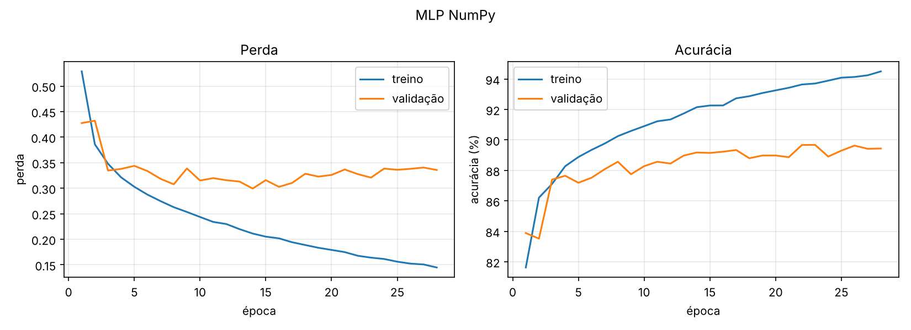
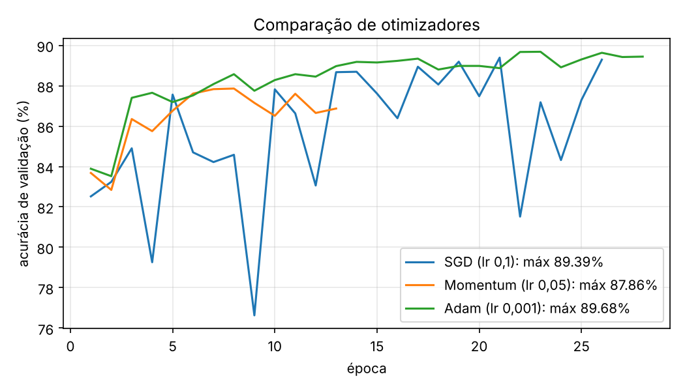
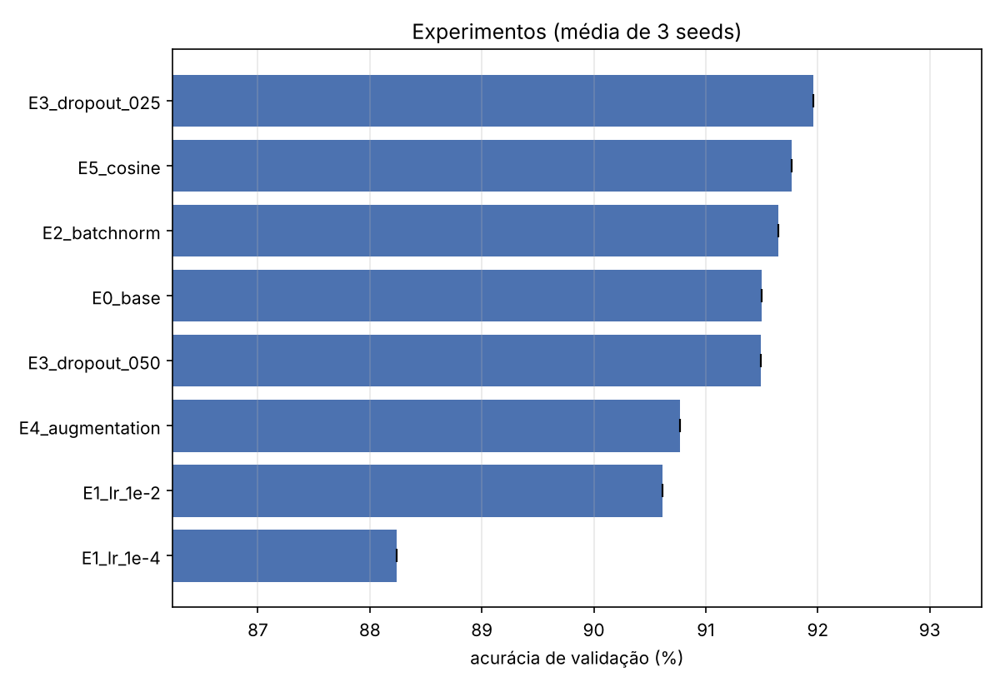
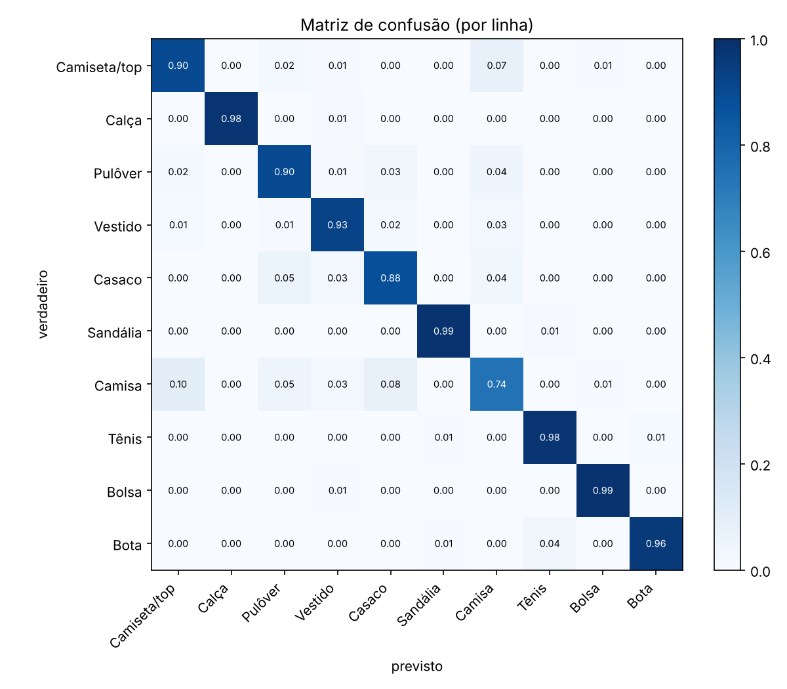
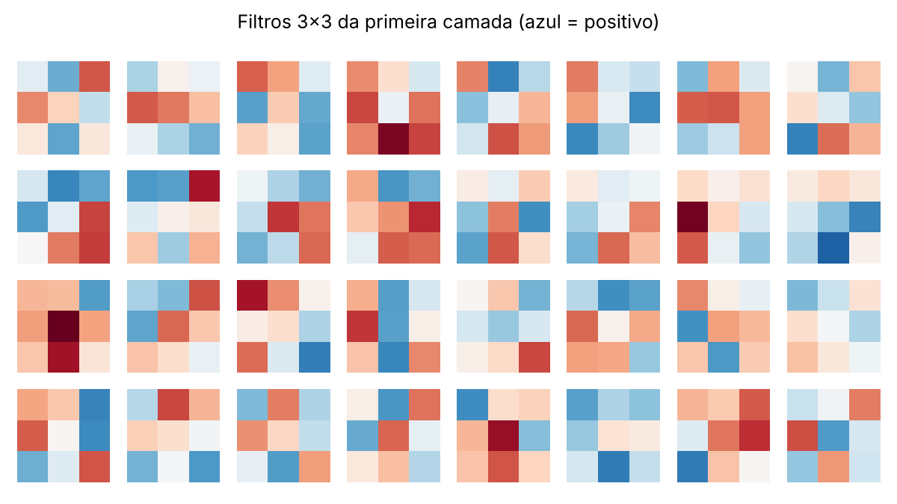
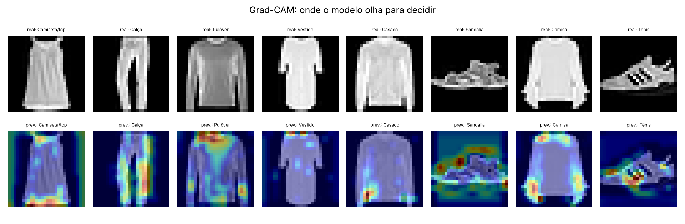
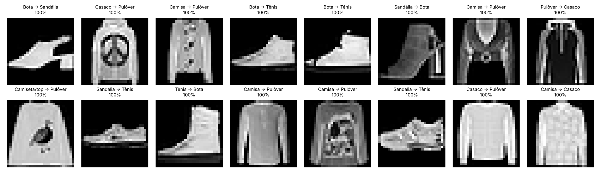

# Rede neural do zero ao PyTorch
 
[](https://github.com/vicvictorius/neural-network-from-scratch/actions)


 
Uma rede neural implementada **do zero em NumPy** (forward, backpropagation e otimizadores), comprovadamente equivalente ao **PyTorch**, e depois evoluída para uma **CNN** com experimentos controlados no [Fashion-MNIST](https://github.com/zalandoresearch/fashion-mnist).
 
<!-- Depois de publicar a demo, descomente: -->
<!-- **[Experimente a demo no Hugging Face](https://huggingface.co/spaces/vicvictorius/fashion-mnist-do-zero)** -->
 
## Sumário
 
- [Resultados](#resultados)
- [Por que construir do zero](#por-que-construir-do-zero)
- [Como rodar](#como-rodar)
- [Estrutura](#estrutura)
- [Fase 1: rede neural em NumPy](#fase-1-rede-neural-em-numpy)
- [Fase 2: NumPy x PyTorch](#fase-2-numpy-x-pytorch)
- [Fase 3: CNN e experimentos](#fase-3-cnn-e-experimentos)
- [Interpretabilidade](#interpretabilidade)
- [Qualidade e testes](#qualidade-e-testes)
- [Demo](#demo)
- [O que aprendi](#o-que-aprendi)
- [Limitações](#limitações)
- [Referências](#referências)
## Resultados
 
| Modelo | Implementação | Acurácia de teste | Meta |
| --- | --- | --- | --- |
| MLP 784-128-64-10 | NumPy, backprop manual | **88,86 %** | ≥ 85 % |
| MLP 784-128-64-10 | PyTorch | **89,08 %** | ≥ 87 % |
| CNN (configuração final) | PyTorch | **92,39 %** | ≥ 91 % |
 
Cada número de teste foi medido **uma única vez**, no modelo final de cada fase. Todas as escolhas de hiperparâmetros usaram o conjunto de validação (10.000 imagens separadas do treino).
 
## Por que construir do zero
 
<!--
Escreva aqui, com as suas palavras (3 a 5 frases). Perguntas para guiar:
- O que você sentia que usava sem entender (backprop, autograd, otimizadores)?
- Por que Fashion-MNIST e não outro dataset?
- O que você queria ser capaz de explicar ao final?
-->
 
## Como rodar
 
Requer Python 3.11 ou superior.
 
```bash
python -m venv .venv && source .venv/bin/activate   # Windows: .venv\Scripts\activate
pip install -r requirements.txt
python -m src.data                                              # baixa o Fashion-MNIST
python -m src.numpy_nn.train --config configs/numpy_mlp.yaml    # Fase 1
python -m src.torch_nn.train --config configs/torch_mlp.yaml    # Fase 2
python -m scripts.run_experiments --plan configs/experiments_rapido.yaml --seeds 0   # Fase 3
python -m src.torch_nn.train --config configs/cnn_final.yaml --evaluate-test         # modelo final
pytest                                                          # testes
python app/app.py                                               # demo local
```
 
Para instalar o PyTorch apenas para CPU (download menor):
 
```bash
pip install torch==2.5.1 torchvision==0.20.1 --index-url https://download.pytorch.org/whl/cpu
```
 
> Os pesos treinados (`checkpoints/`) e os dados (`data/`) não são versionados. Rode os comandos acima para gerá-los.
 
## Estrutura
 
```
src/numpy_nn/   camadas, ativações, perda, otimizadores e treino em NumPy puro
src/torch_nn/   MLP e CNN em PyTorch, augmentation, treino e interpretabilidade
src/utils/      seeds, configs, métricas e gráficos
configs/        um YAML por experimento (nenhum hiperparâmetro fixo no código)
tests/          gradient checks, equivalência NumPy x PyTorch, testes de overfit
scripts/        experimentos em lote, comparações, verificação local (lint + testes)
notebooks/      exploração e análises de cada fase
app/            demo em Gradio
docs/           derivações matemáticas e guia do projeto
results/        métricas, curvas e figuras de cada experimento
```
 
## Fase 1: rede neural em NumPy
 
Toda camada implementa a mesma interface (`forward`, `backward`, `params`, `grads`), o que permite empilhá-las num `Sequential` e separar o cálculo de gradientes (camadas) da atualização dos pesos (otimizadores), como no PyTorch.
 
O ponto central é o gradiente de Softmax + Cross-Entropy em relação aos logits, que se reduz a uma subtração (dedução completa em [`docs/derivacoes.md`](docs/derivacoes.md)):
 
$$\frac{\partial L}{\partial Z} = \frac{1}{N}(P - Y)$$
 
Cada `backward` é verificado contra o gradiente numérico por diferenças centrais, com erro relativo abaixo de 1e-6. Um teste de sanidade confirma que a rede consegue decorar um conjunto pequeno, o sinal mais rápido de bug no backpropagation.
 

 
Comparação de otimizadores (melhor acurácia de validação): Adam 89,68 %, SGD 89,39 %, SGD com momentum 87,86 %. As taxas de aprendizado não foram otimizadas para cada otimizador, então a comparação é indicativa.
 

 
## Fase 2: NumPy x PyTorch
 
| Critério | NumPy | PyTorch |
| --- | --- | --- |
| Melhor acurácia de validação (%) | 89,68 | 89,73 |
| Épocas até o early stopping | 28 | 21 |
| Segundos por época | 2,3 | 1,7 |
| Linhas de código | 374 | 212 |
| Cálculo do gradiente | manual (backward à mão) | automático (autograd) |
 
O teste [`tests/test_equivalence.py`](tests/test_equivalence.py) copia os mesmos pesos para as duas redes e confirma que perda e gradientes coincidem até 1e-8. As curvas de treino diferem apenas pela aleatoriedade (inicialização e ordem dos batches).
 
## Fase 3: CNN e experimentos
 
Arquitetura base: 2 blocos [Conv 3×3 → ReLU → MaxPool 2×2] com 32 e 64 filtros, seguidos de Dense 128 → Dense 10 (421.642 parâmetros). Cada experimento muda **uma** variável em relação à base.
 
| Experimento | Acurácia de validação (%) | Desvio | s/época |
| --- | --- | --- | --- |
| E3_dropout_025 | 91,96 | n/d (1 seed) | 35,7 |
| E5_cosine | 91,77 | n/d (1 seed) | 35,1 |
| E2_batchnorm | 91,65 | n/d (1 seed) | 47,4 |
| E0_base | 91,50 | n/d (1 seed) | 47,3 |
| E3_dropout_050 | 91,49 | n/d (1 seed) | 33,5 |
| E4_augmentation | 90,77 | n/d (1 seed) | 34,9 |
| E1_lr_1e-2 | 90,61 | n/d (1 seed) | 39,4 |
| E1_lr_1e-4 | 88,24 | n/d (1 seed) | 41,0 |
 

 
O que os experimentos mostraram:
 
- **Taxa de aprendizado (E1)** foi a variável de maior impacto: 1e-4 aprende devagar demais em 8 épocas e 1e-2 fica instável; 1e-3 (a base) é a melhor das três.
- **Dropout 0,25 (E3)** deu o melhor resultado e praticamente eliminou a diferença entre treino e validação. Com 0,5, a regularização passou do ponto.
- **Cosine scheduler (E5)** e **batch normalization (E2)** trouxeram ganhos pequenos sobre a base.
- **Augmentation (E4)** piorou a validação em 8 épocas, mas deixou a acurácia de treino abaixo da de validação: a rede ainda não tinha aprendido a tarefa mais difícil. É o tipo de técnica que costuma render só em treinos longos.
O modelo final combina as três técnicas que superaram a base.
 
**Sobre o protocolo:** por limite de hardware (CPU de 1 núcleo, ~35 s por época), os experimentos acima usaram 1 seed e 8 épocas cada (`configs/experiments_rapido.yaml`). Diferenças menores que ~0,3 p.p. estão dentro da variação entre seeds e não devem ser lidas como conclusivas. O protocolo completo, com 3 seeds e 20 épocas, está em `configs/experiments.yaml`:
 
```bash
python -m scripts.run_experiments --seeds 0 1 2   # retomável: se parar no meio, rode de novo
```
 
**Modelo final** (`configs/cnn_final.yaml`): batch normalization + dropout 0,25 + cosine scheduler, 15 épocas. Validação 92,93 %, teste **92,39 %**.
 

 
## Interpretabilidade
 
Filtros da primeira camada, Grad-CAM e os erros mais confiantes do modelo final:
 



 
Confusões mais frequentes no teste: Camisa classificada como Camiseta/top (96 vezes); Camisa classificada como Casaco (78 vezes); Camiseta/top classificada como Camisa (74 vezes). São justamente as classes de formato parecido (peças de parte de cima), o que também aparece na imagem média por classe do notebook `00_exploracao`.
 
## Qualidade e testes
 
- **Testes:** 49 testes, 93 % de cobertura (gradient checks, equivalência NumPy x PyTorch, overfit de sanidade, pipelines de ponta a ponta).
- **Lint:** [ruff](https://docs.astral.sh/ruff/) configurado em `pyproject.toml`, com hooks de [pre-commit](https://pre-commit.com/).
- **CI:** GitHub Actions roda lint e testes com cobertura a cada push na `main` e em pull requests.
- **Verificação local**, equivalente ao CI:
```bash
bash scripts/check.sh          # Windows: .\scripts\check.ps1
```
 
## Demo
 
A demo em Gradio classifica uma imagem de peça de roupa nas 10 classes do Fashion-MNIST. Para rodar localmente, treine o modelo final e copie os pesos:
 
```bash
python -m src.torch_nn.train --config configs/cnn_final.yaml --evaluate-test
cp checkpoints/E6_final.pt app/model.pt
python app/app.py
```
 
A pasta `app/examples/` traz uma imagem de exemplo por classe.
 
## O que aprendi
 
<!--
Esta é a seção mais importante para quem avalia o projeto, e precisa ser sua.
Sugestões:
- O que mudou no seu entendimento de backpropagation.
- Um bug real que você encontrou e como descobriu a causa.
- O que te surpreendeu nos experimentos.
- O que faria diferente numa segunda versão.
Dica: o diário em docs/aprendizados.md serve de matéria-prima.
-->
 
## Limitações
 
- Imagens 28×28 em tons de cinza, centralizadas e sem fundo: fotos reais funcionam pior na demo.
- Experimentos da CNN com 1 seed e 8 épocas (ver "Sobre o protocolo").
- A comparação de otimizadores da Fase 1 não otimizou a taxa de aprendizado de cada um.
## Licença
 
Distribuído sob a licença MIT. Veja [`LICENSE`](LICENSE).
 
## Referências
 
- Nielsen, M. *Neural Networks and Deep Learning*.
- Stanford CS231n, notas de aula.
- Karpathy, A. *Neural Networks: Zero to Hero*.
- Xiao, H., Rasul, K., Vollgraf, R. (2017). *Fashion-MNIST: a Novel Image Dataset for Benchmarking Machine Learning Algorithms*.
- Selvaraju, R. et al. (2017). *Grad-CAM: Visual Explanations from Deep Networks via Gradient-based Localization*.
